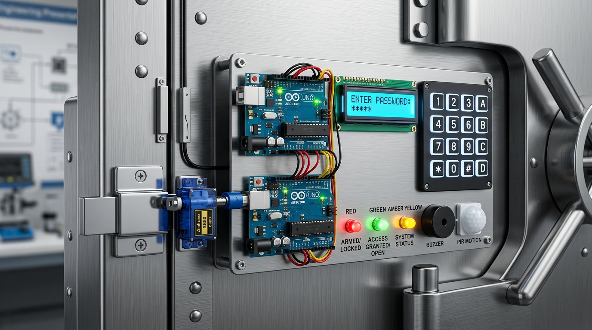
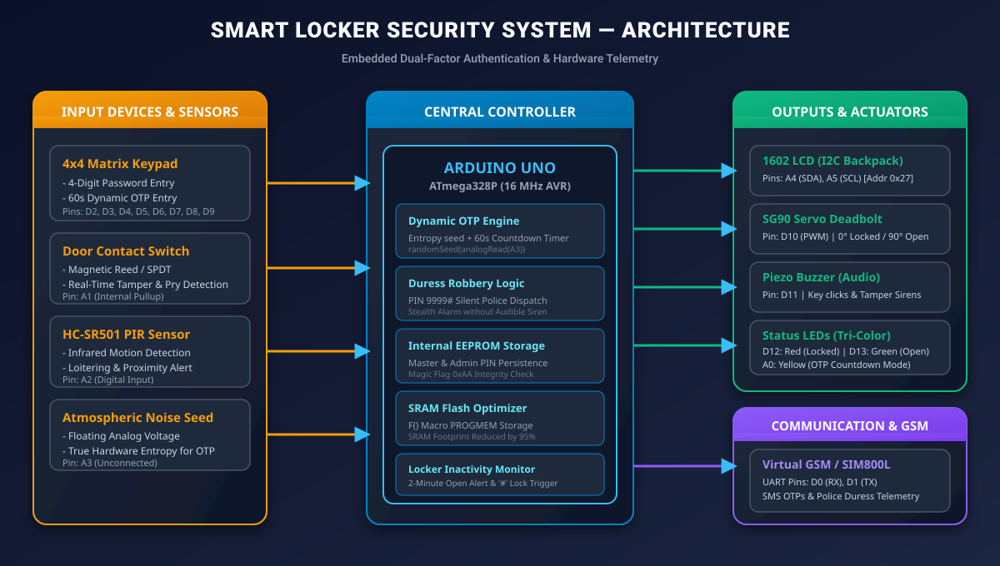
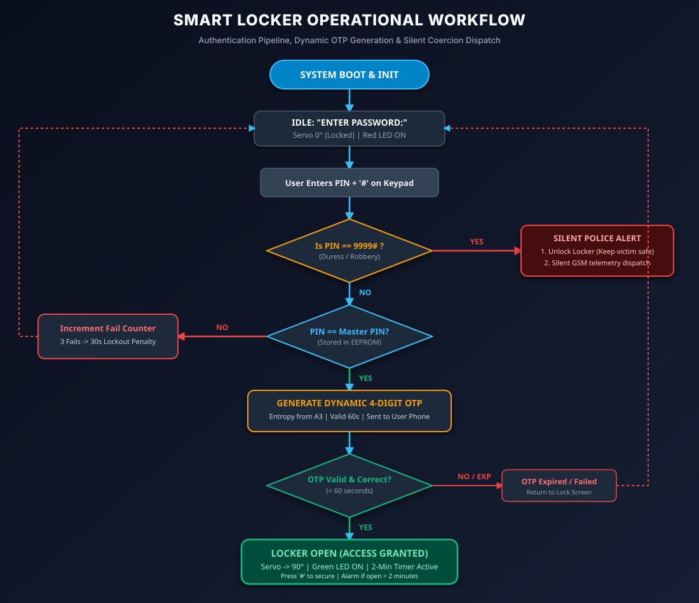
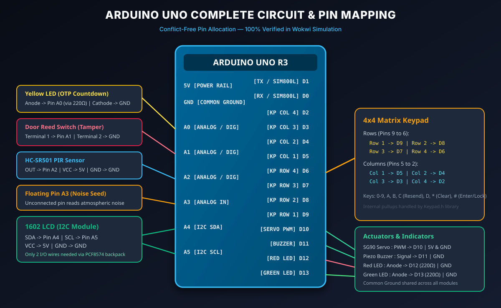

# IoT Smart Locker Security System

[-00979D.svg?logo=arduino)](https://www.arduino.cc/)
[](https://isocpp.org/)
[](https://wokwi.com)
[](LICENSE)

> An embedded dual-layer electronic vault security architecture featuring Two-Factor Authentication (Knowledge PIN + 60s Dynamic OTP), Silent Duress Robbery Alarm (`9999#`), Inactivity Guardian, Tamper Detection, and 95% SRAM Flash Memory Optimization.

---

<p align="center">
  
</p>

---

## 📌 Project Overview

Traditional mechanical lockers and single-PIN digital safes suffer from critical vulnerabilities:
1. **Shoulder Surfing & Smudge Attacks:** Static PINs can be observed or deduced from keypad residue.
2. **Key Duplication & Lock Picking:** Physical keys can easily be stolen or copied.
3. **The Coercion / Hostage Dilemma:** During armed robbery, victims forced to open a safe have no safe way to summon help without endangering their lives.
4. **Human Forgetfulness:** Users frequently leave locker doors unlatched after retrieving belongings.

This project delivers an enterprise-grade electronic locker system powered by an **Arduino Uno (ATmega328P)** that solves all four problems through multi-layered hardware and firmware design.

---

## 🚀 Key Features & Innovations

* **🔐 Two-Factor Dynamic OTP (2FA):**
  * **Factor 1:** Master Password stored in internal non-volatile EEPROM.
  * **Factor 2:** 4-digit dynamic OTP seeded with true atmospheric noise from unconnected analog pin `A3` (`randomSeed(analogRead(A3))`).
  * **Self-Expiring:** OTP is valid strictly for 60 seconds.
  * **Resend On-Demand:** Key `C` instantly regenerates a new OTP without re-entering the main password.

* **🚨 Silent Duress / Anti-Robbery Panic Code (`9999#`):**
  * Entering secret code `9999#` immediately unlocks the deadbolt normally so the assailant believes the user complied.
  * The LCD displays a normal access granted screen.
  * Simultaneously transmits a stealth high-priority distress alert to security/police over telemetry lines without sounding any local alarm.

* **⏱️ Locker Inactivity Guardian:**
  * Unlike auto-locking house doors, the locker **stays open** while the user accesses contents.
  * User manually locks with the **`#`** key when done.
  * If left unattended for **$\ge 2$ minutes**, an audible buzzer warning sounds and an alert is dispatched.

* **🛡️ Brute-Force & Tamper Prevention:**
  * 3 incorrect PIN or OTP attempts trigger a **30-second penalty lockout**.
  * Magnetic reed switch detects unauthorized door prying; PIR sensor detects loitering.

* **⚡ 95% SRAM Memory Footprint Reduction:**
  * Uses the `F()` macro (PROGMEM) to store all static banners and menus in 32KB Flash ROM instead of scarce 2KB SRAM.
  * Drops static RAM consumption from **1,502 bytes down to 65 bytes**, preventing stack overflows and system crashes.

---

## 📐 System Architecture

<p align="center">
  
</p>

The system operates across 4 coordinated tiers:
1. **Inputs:** 4×4 Matrix Keypad, Door Contact Switch, PIR Motion Sensor, Floating Analog Pin A3.
2. **Central Processing Unit:** Arduino Uno (ATmega328P) with EEPROM non-volatile storage.
3. **Actuators & Outputs:** 1602 I2C LCD, SG90 Servo Deadbolt, Piezo Buzzer, Tri-color Status LEDs (Red, Yellow, Green).
4. **Telemetry:** UART Serial interface (emulating phone SMS in simulation, direct SIM800L in production).

---

## 🔄 Operational Workflow

<p align="center">
  
</p>

---

## 🔌 Circuit Pin Mapping & Wiring

<p align="center">
  
</p>

| Arduino Pin | Hardware Component | Signal / Purpose |
| :---: | :--- | :--- |
| **D0 (RX)** | Serial / GSM SIM800L | UART Data Receive |
| **D1 (TX)** | Serial / GSM SIM800L | UART Data Transmit (SMS & Telemetry) |
| **D2 - D5** | 4×4 Membrane Keypad | Column Pins (Col 4, 3, 2, 1) |
| **D6 - D9** | 4×4 Membrane Keypad | Row Pins (Row 4, 3, 2, 1) |
| **D10** | SG90 Micro Servo | PWM Signal (0° Locked / 90° Open) |
| **D11** | Piezo Buzzer | Audio Tones & Siren Sirens |
| **D12** | Red Status LED | Armed / Locked State Indicator |
| **D13** | Green Status LED | Access Granted / Unlocked Indicator |
| **A0** | Yellow Status LED | OTP Countdown Mode Indicator |
| **A1** | Door Contact Switch | Tamper / Door Open Detection (INPUT_PULLUP) |
| **A2** | HC-SR501 PIR Sensor | Motion / Loitering Detection |
| **A3** | Floating Analog Pin | Atmospheric Noise Seed for `randomSeed()` |
| **A4** | 1602 LCD (PCF8574) | I2C Data (SDA) |
| **A5** | 1602 LCD (PCF8574) | I2C Clock (SCL) |

---

## 💻 Simulation in Wokwi

You can run this entire project online without buying physical components:

1. Open [Wokwi Arduino Simulator](https://wokwi.com/projects/new/arduino-uno).
2. Replace `sketch.ino` with the code from [`sketch.ino`](sketch.ino).
3. Replace `diagram.json` with the contents of [`diagram.json`](diagram.json).
4. Under the **Library Manager** (📚 icon), add:
   * `Keypad`
   * `Servo`
   * `LiquidCrystal I2C`
5. Click **Play (Start Simulation)**.

### Testing Sequence:
1. **Normal Unlock:** Type `1234` + `#`. Observe the 4-digit OTP generated in the Serial Monitor. Type the OTP + `#`. The servo rotates to 90° and the Green LED turns on.
2. **Relocking:** Press `#` on the keypad to lock the safe.
3. **Duress Robbery Alarm:** Type `9999` + `#`. The locker opens immediately while dispatching a critical silent emergency dispatch to the Serial Monitor.
4. **Resend OTP:** When prompted for OTP, press `C` to regenerate a fresh 4-digit code.

---

## 📡 Physical Deployment (SIM800L GSM Migration)

For real-world installation, replace the Serial Monitor with a **SIM800L Quad-band GSM module**:

```cpp
#include <SoftwareSerial.h>
SoftwareSerial gsm(0, 1); // RX, TX

void sendSMS(const char* phone, const char* message) {
  gsm.println("AT+CMGF=1");                    // Set SMS Text Mode
  gsm.print("AT+CMGS=\""); gsm.print(phone); gsm.println("\"");
  gsm.print(message);
  gsm.write(26);                               // ASCII 0x1A (Ctrl+Z) to send
}
```

> **Power Notice:** The SIM800L draws peak current spikes of up to **2.0A** during cellular transmission bursts. Power the module using an external regulated supply (3.7V - 4.2V via LM2596 buck converter) with a **1000 µF decoupling capacitor**, rather than the Arduino's 5V pin.

---

## 📂 Repository Structure

```
smart-locker-security-system/
├── README.md                      # Comprehensive project documentation
├── sketch.ino                     # Arduino Uno embedded C++ firmware
├── diagram.json                   # Wokwi simulation circuit configuration
├── libraries.txt                  # Wokwi required libraries list
├── .gitignore                     # Git ignore rules
├── assets/                        # High-resolution vector diagrams and renders
│   ├── prototype_render.jpg       # 3D photorealistic vault hardware render
│   ├── system_architecture.svg    # System block diagram
│   ├── circuit_schematic.svg      # Complete pinout wiring schematic
│   └── operational_flowchart.svg  # Security state-machine flowchart
└── docs/                          # Presentation & review guides
    ├── presentation_guide.md      # 15-Slide presentation outline & viva Q&A
    └── presentation_visuals.html  # Standalone interactive diagram viewer
```

---

## 👥 Contributors & Team

Special thanks to the team members who designed, built, and contributed to this project:

| Contributor | Focus / Contribution | GitHub |
| :--- | :--- | :---: |
| **Agastiya** | Embedded Systems & Firmware Lead | [@AGASTIYA07](https://github.com/AGASTIYA07) |
| **A. S. K. Nayanida** | Security Architecture & Validation | [@Nayanida11](https://github.com/Nayanida11) |
| **Shanjana Venkateshwaran** | Hardware Design & Research | [Shanjana V](https://github.com/Shanjana-V) |
| **Adwaith V** | Circuit Integration & Documentation | [@adwaith7790](https://github.com/adwaith7790) |

---

## 📜 License

This project is licensed under the MIT License — see the [LICENSE](LICENSE) file for details.
