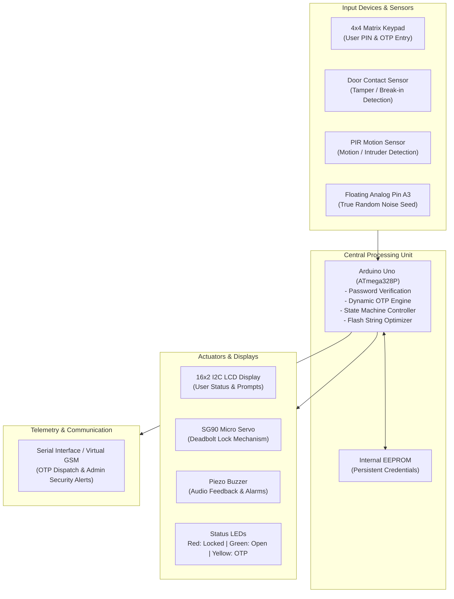

# Smart Locker Security System — Presentation (PPT) Guide

A complete, slide-by-slide presentation deck designed for academic project reviews, viva examinations, and project showcases.

---

## Slide Overview & Outline

| Slide # | Slide Title | Key Objective |
| :---: | :--- | :--- |
| **1** | Title Slide | Introduce the project, team members, and institution |
| **2** | Problem Statement & Motivation | Why traditional mechanical/single-PIN locks fail |
| **3** | Proposed System & Objectives | Dual-factor security, dynamic OTP, and robbery protection |
| **4** | System Architecture | High-level block diagram of inputs, controller, and outputs |
| **5** | Hardware Components & Specifications | Detailed bill of materials, pin assignments, and roles |
| **6** | Working Principle & Operational Flow | Complete flowchart of authentication, OTP, and relocking |
| **7** | Core Security Features | 2FA OTP, Duress Panic PIN, Left-Open alarm, Lockout |
| **8** | Circuit Design & Pin Mapping | Complete wiring and schematic explanation |
| **9** | Software Architecture & Optimizations | Embedded C++ algorithms, EEPROM storage, RAM optimization |
| **10** | Simulation & Experimental Results | Wokwi simulation results, Serial logs, LCD outputs |
| **11** | Physical Prototype & Real-World Integration | GSM SIM800L migration, cellular AT commands |
| **12** | Advantages & Real-World Applications | Bank vaults, gym lockers, parcel lockers, jewellery safes |
| **13** | Future Scope & Enhancements | Biometrics (fingerprint), RFID card tap, Cloud IoT |
| **14** | Conclusion & Key Takeaways | Summary of achievements and impact |
| **15** | Viva / Q&A Preparation | Top questions professors ask and how to answer them |

---

## Slide 1: Title Slide

* **Title:** IoT-Enabled Smart Locker Security System with Two-Factor Dynamic OTP & Silent Robbery Alarm
* **Subtitle:** An Embedded Dual-Layer Electronic Vault Architecture using Arduino
* **Presented by:** [Your Name / Team Members]
* **Department:** Department of Electronics & Communication / Computer Science Engineering
* **Institution:** [Your College / University Name]
* **Academic Year / Semester:** 2026 – 2027

> **💡 Speaker Notes:**
> *"Good morning respected evaluators. Today, we present our project: an advanced Smart Locker Security System that solves the critical vulnerabilities of modern physical lockers by combining two-factor OTP authentication with a silent coercion alarm for robbery situations."*

---

## Slide 2: Problem Statement & Motivation

### Key Bullet Points:
* **Vulnerabilities of Conventional Locks:**
  * Physical mechanical keys can be duplicated, picked, or stolen.
  * Static digital combination locks suffer from **shoulder surfing** (peeping) and smudge attacks on keypad glass.
* **The Hostage / Coercion Dilemma:**
  * In conventional safes, if an intruder threatens the owner at gunpoint, opening the safe leaves the victim with no way to summon help.
* **Human Forgetfulness:**
  * Users frequently leave locker doors unlatched or unattended after retrieving items.
* **Need for Multi-Factor Authentication (MFA):**
  * Modern banking and digital systems enforce 2FA; physical lockers require the same standard of hardware protection.

---

## Slide 3: Proposed System & Objectives

### Main Objectives:
1. **Implement Two-Factor Authentication (2FA):**
   * **Factor 1:** Knowledge-based Master Password.
   * **Factor 2:** Possession-based Dynamic 4-Digit One-Time Password (OTP) generated on-the-fly with 60-second validity.
2. **Duress / Anti-Robbery Panic Mode:**
   * Secret coercion PIN (`9999#`) that unlocks the vault normally to safeguard the hostage while silently transmitting a high-priority distress alert to authorities.
3. **Locker-Specific Inactivity Management:**
   * Locker stays open while user accesses contents; manual lock via `#` key.
   * Auto-alert alarm triggered if locker remains unattended for $\ge 2$ minutes.
4. **Brute-Force & Tamper Prevention:**
   * 3-strike lockout with 30-second penalty.
   * Magnetic door pry sensor and PIR intrusion detection.

---

## Slide 4: System Architecture & Block Diagram



---

## Slide 5: Hardware Components & Specifications

| Component | Model / Type | Interface / Pin | Operational Function |
| :--- | :--- | :--- | :--- |
| **Microcontroller** | Arduino Uno (ATmega328P) | 16 MHz, 2KB SRAM, 32KB Flash | Master controller running security logic |
| **Keypad** | 4×4 Membrane Keypad | Pins 9, 8, 7, 6 (Rows) / 5, 4, 3, 2 (Cols) | User PIN entry, OTP entry, admin controls |
| **Display** | 1602 LCD with PCF8574 I2C | Pins A4 (SDA), A5 (SCL) | Visual instructions and system status |
| **Lock Actuator** | SG90 Micro Servo | Pin 10 (PWM) | Physical locking deadbolt (0° = Locked, 90° = Open) |
| **Audio Feedback** | Piezo Buzzer | Pin 11 (PWM) | Key clicks, unlock chimes, tamper sirens |
| **Status LEDs** | 5mm Diffused LEDs | Pins 12 (Red), 13 (Green), A0 (Yellow) | Visual operational status indication |
| **Door Sensor** | SPDT Slide Switch / Reed Switch | Pin A1 (INPUT_PULLUP) | Monitors physical door contact (tamper detection) |
| **Motion Sensor** | HC-SR501 PIR Sensor | Pin A2 (Digital Input) | Detects unauthorized proximity/loitering |

---

## Slide 6: Working Principle & Operational Flow

```mermaid
flowchart TD
    Start([System Boot]) --> Init[Initialize Hardware, LCD & EEPROM]
    Init --> Idle[Display: ENTER PASSWORD]
    
    Idle --> KeyInput[/User Enters Key on Keypad/]
    KeyInput --> IsDuress{Is PIN == 9999# ?}
    
    IsDuress -- Yes --> DuressAction[1. Unlock Locker Immediately\n2. SILENT Emergency Alert to Police\n3. Display: ACCESS GRANTED]
    
    IsDuress -- No --> CheckPass{Is PIN == Master Password?}
    
    CheckPass -- No --> IncFail[Increment Fail Counter]
    IncFail --> CheckMax{Fails >= 3 ?}
    CheckMax -- Yes --> Lockout[Trigger 30s Lockout + Admin Alert]
    Lockout --> Idle
    CheckMax -- No --> Idle
    
    CheckPass -- Yes --> GenOTP[Generate Random 4-Digit OTP\nSend OTP to User Phone\nStart 60s Validity Timer]
    GenOTP --> AwaitOTP[Display: ENTER OTP\nC: Resend | *: Back]
    
    AwaitOTP --> UserOTP[/User Enters OTP/]
    UserOTP --> CheckOTP{OTP Matches & Valid?}
    
    CheckOTP -- No / Expired --> FailOTP[Increment Fail Counter / Expired Alert]
    FailOTP --> Idle
    
    CheckOTP -- Yes --> Unlock[Unlock Servo to 90°\nGreen LED ON\nStart Inactivity Timer]
    Unlock --> OpenState[Locker Open State]
    
    OpenState --> CheckManual{User Pressed '#' ?}
    CheckManual -- Yes --> Relock[Rotate Servo to 0°\nLog Usage Duration\nLocker Secured]
    Relock --> Idle
    
    OpenState --> CheckTimer{Open Time >= 2 Min ?}
    CheckTimer -- Yes --> Alarm[Sound Buzzer Alarm\nSend Warning Alert]
    Alarm --> OpenState
```

---

## Slide 7: Core Security Innovations

### 1. Dual-Factor Authentication (Dynamic OTP):
* Master password alone cannot open the vault.
* System generates a random pseudo-unpredictable 4-digit code using entropy seeded from floating analog pin `A3` (`randomSeed(analogRead(A3))`).
* OTP is valid strictly for **60 seconds**.
* **Key `C` Feature:** User can regenerate a fresh OTP on demand without re-typing their main password.

### 2. Silent Coercion / Duress Robbery Alarm:
* Standard safe protocol: Entering secret code `9999#` unlocks the locker normally.
* LCD displays normal access granted screen so the criminal suspects nothing.
* Arduino immediately transmits a stealth emergency distress signal to security:
  ```
  ALERT   : DURESS_COERCION
  MESSAGE : LOCKER OPENED UNDER THREAT!
  ACTION  : >> DISPATCHING POLICE / SECURITY <<
  ```

### 3. Inactivity "Left-Open" Guardian:
* Traditional door locks auto-lock in 5 seconds. Lockers must remain accessible while in use.
* User manually locks with **`#`** when finished.
* If forgotten for $> 2\text{ minutes}$, audible and remote alerts sound until secured.

---

## Slide 8: Circuit Design & Schematic Summary

### Pin Distribution Table:

```
                  +---------------------------+
                  |        ARDUINO UNO        |
                  +---------------------------+
                  | D0 (RX)  <-- Serial / GSM |
                  | D1 (TX)  --> Serial / GSM |
Keypad Col 4 <--- | D2                        |
Keypad Col 3 <--- | D3                        |
Keypad Col 2 <--- | D4                        |
Keypad Col 1 <--- | D5                        |
Keypad Row 4 <--- | D6                        |
Keypad Row 3 <--- | D7                        |
Keypad Row 2 <--- | D8                        |
Keypad Row 1 <--- | D9                        |
Servo PWM    <--- | D10                       |
Buzzer       <--- | D11                       |
Red LED      <--- | D12                       |
Green LED    <--- | D13                       |
Yellow LED   <--- | A0                        |
Door Sensor  <--- | A1 (INPUT_PULLUP)         |
PIR Sensor   <--- | A2                        |
Noise Seed   <--- | A3 (Unconnected Analog)   |
I2C SDA      <--- | A4 (LCD SDA)              |
I2C SCL      <--- | A5 (LCD SCL)              |
                  +---------------------------+
```

* **Zero Pin Conflicts:** Every single digital and analog pin has a dedicated, conflict-free role.
* **I2C Bus Efficiency:** Using the PCF8574 backpack reduces LCD pin count from 16 pins down to just 2 wires (`A4` & `A5`).

---

## Slide 9: Software Architecture & Memory Optimization

### Key Embedded Engineering Highlights:
* **The 2KB SRAM Challenge:**
  * Arduino Uno has only 2,048 bytes of SRAM.
  * Over 50 static UI and alert strings initially consumed 1,500+ bytes, causing build failures and memory stack collision.
* **Optimization with `F()` Macro (PROGMEM):**
  * All static UI strings and telemetry banners were moved into Flash Program Memory:
    ```cpp
    Serial.println(F("========================================"));
    lcd.print(F("ENTER PASSWORD:"));
    notifyAdmin(F("ACCESS_GRANTED"), F("Locker unlocked via OTP"));
    ```
  * **Result:** Reduced static RAM consumption from **1,502 bytes down to 65 bytes** (a **95% memory footprint reduction**).
* **Non-Volatile EEPROM Persistence:**
  * Credentials (`userPass` and `adminPass`) are stored in internal EEPROM memory with a validation flag byte (`0xAA`). Passwords survive power cuts and resets.

---

## Slide 10: Simulation & Experimental Results

### Terminal Telemetry Output (Wokwi Simulation):

```
========================================
     SMART LOCKER v3 -- OTP SYSTEM      
========================================
Step 1: Enter password (1234) + #       
Step 2: OTP sent to Serial Monitor      
Step 3: Enter OTP on keypad + #         
Lock  : Press # when done to lock locker
Panic : Enter 9999 + # (Duress Alarm)   
Resend: Press C to regenerate OTP       
Admin : Press D, then 0000 + #          
Clear : Press * to reset input          
========================================

[User enters 1234#]

========================================
      ** OTP SENT TO YOUR PHONE **      
========================================
YOUR OTP : 4729
VALIDITY : 60 seconds (Enter code + #)
RESEND   : Press 'C' on keypad to resend
========================================

[User enters 4729#]

========================================
     *** ADMIN ALERT NOTIFICATION ***   
========================================
ALERT    : ACCESS_GRANTED
MESSAGE  : Locker unlocked via OTP
TIME     : 24 seconds uptime
ATTEMPTS : 0
STATUS   : >> Sent to admin's phone <<
========================================

[User presses # when done]

========================================
        LOCKER SECURED & CLOSED         
========================================
Access Duration : 18 seconds
Status          : Vault locked successfully
========================================
```

---

## Slide 11: Physical Prototype & Real-World Implementation

### Migration from Simulation to Hardware:
* **Cellular SMS Integration via GSM SIM800L:**
  * In simulation, the Serial Monitor emulates the phone.
  * In physical deployment, the UART TX/RX lines connect to a **SIM800L module** running standard AT commands:
    ```cpp
    gsm.println("AT+CMGF=1");                        // Set to SMS Text Mode
    gsm.println("AT+CMGS=\"+919876543210\"");         // Recipient Phone Number
    gsm.print("Your Locker OTP is: 4729 (Valid 60s)");
    gsm.write(26);                                   // Send (Ctrl+Z)
    ```
* **Power Supply Architecture:**
  * Dual-rail power supply: 5V regulated for Arduino/LCD, external 4V/2A lithium-ion source for high-current GSM module bursts and servo torque.
* **Mechanical Deadbolt:**
  * SG90 micro-servo coupled with a 3D-printed rack-and-pinion sliding deadbolt latch.

---

## Slide 12: Advantages & Applications

### Key Advantages:
* ✅ **High Security:** Immune to key duplication, lock picking, and shoulder surfing.
* ✅ **Coercion-Safe:** Protects human life during armed robberies via silent duress alarm.
* ✅ **Cost-Effective:** Built on readily available, low-power embedded components.
* ✅ **Zero Cloud Dependency:** Functions in offline environments using cellular SMS.

### Target Applications:
* **Banking Sector:** Safe deposit lockers and custodian vaults.
* **Commercial & Retail:** Jewellery stores, cash registers, and pharmacy medicine vaults.
* **Smart Campus & Gyms:** Student lockers and fitness center storage.
* **Automated Logistics:** Parcel delivery lockers (Amazon/DHL drop-off kiosks).

---

## Slide 13: Future Scope & Enhancements

* **3-Factor Authentication (3FA):**
  * Integrate an **MFRC522 RFID reader** (Card Tap + Password + Phone OTP).
* **Biometric Verification:**
  * Optical fingerprint sensor (R307) for keyless biometric identification.
* **Cloud & Mobile App Integration:**
  * Upgrade to ESP32 for direct WiFi/MQTT telemetry, Firebase database logging, and mobile app push notifications.
* **Real-Time Clock (RTC DS3231):**
  * Battery-backed calendar timestamps for legal audit logging (e.g., `15-Oct-2026 14:32:10 Locked`).

---

## Slide 14: Conclusion & Key Takeaways

* Successfully engineered a **production-ready Smart Locker Security System** with complete two-factor authentication.
* Solved the real-world **robbery dilemma** using an innovative silent duress code.
* Overcame strict **microcontroller memory limits** using embedded C++ flash optimizations.
* Demonstrated end-to-end functionality across credential management, sensor monitoring, timing controls, and telemetry alerts.

---

## Slide 15: Viva / Exam Q&A Preparation (Professor Questions)

### Q1: Why did you use OTP instead of just two static passwords?
> **Answer:** *"A static secondary password can be memorized, written down, or observed through shoulder surfing. Dynamic OTPs change on every access cycle and expire after 60 seconds, ensuring that stolen credentials become completely useless after one minute."*

### Q2: What is the purpose of connecting analog pin A3 to randomSeed()?
> **Answer:** *"Microcontrollers generate pseudo-random numbers based on mathematical formulas. By reading ambient electrical noise from an unconnected, floating analog pin (`analogRead(A3)`), we inject true atmospheric entropy into the seed, ensuring the generated OTP is unpredictable."*

### Q3: How does the Duress PIN protect the user?
> **Answer:** *"If a user is coerced under threat of violence, refusing to open the locker endangers their life. Entering `9999#` unlocks the safe normally so the criminal believes the owner complied, but the controller silently transmits an emergency panic notification to security or police without any audible alarm."*

### Q4: Why did your code require the `F()` macro?
> **Answer:** *"The ATmega328P has only 2KB of SRAM. By default, string literals are loaded from Flash into RAM at boot. With extensive menus and alert messages, strings consumed over 1,500 bytes of RAM. The `F()` macro forces strings to stay in the 32KB Flash ROM, reducing SRAM consumption by 95%."*

### Q5: How would you deploy this on physical hardware without WiFi?
> **Answer:** *"We interface an industrial GSM SIM800L module over UART pins. The Arduino sends standard AT commands (`AT+CMGS`) to transmit the OTP and security alerts over cellular SMS directly to any standard mobile phone without requiring an internet connection."*
